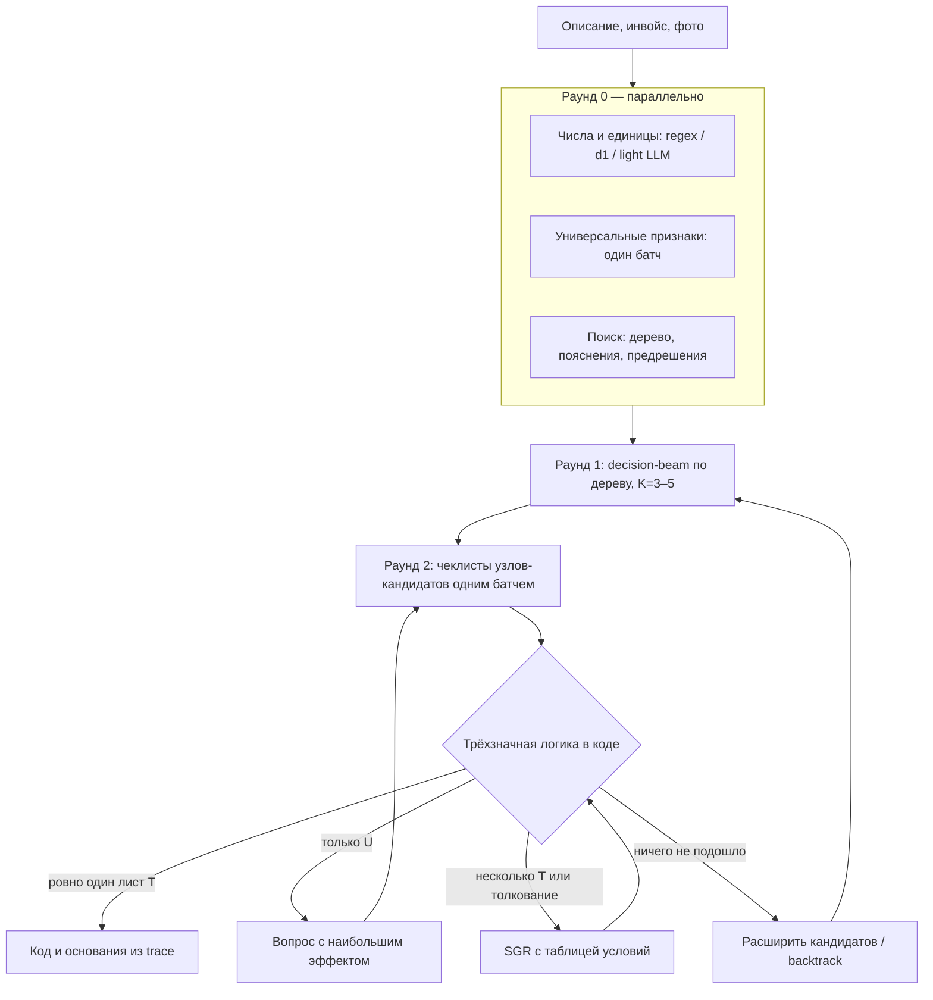

# Движок различающих признаков: SGR компилирует, decision-модель исполняет

Дата: **4 ноября 2026**. Ревизия FEAP: `ca18883`.
Статус: дизайн-предложение и мнение. Ничего не реализовано и не измерено на наших данных.

Обзор рынка, бенчмарков и литературы — в [decision_models_tnved_research.md](decision_models_tnved_research.md).
Его ключевые утверждения перепроверены 4 ноября по первоисточникам: 7 статей arXiv, документация TypeSafe, Liquid,
Cloudflare и OpenAI, репозитории Kev и Jeeves. Расхождений по существу нет. Этот документ про другое: как устроить
«универсальный движок» из decision-моделей и наших SGR-практик и в каком порядке его проверять.

---

## 1. Короткий ответ

1. **Идея правильная, а ТН ВЭД почти идеально подходит под неё по форме.** Дерево закрыто и юридически определено:
   13 279 листьев, 3 423 точки выбора, у самого широкого узла (группа 84) 86 вариантов при лимите Choice 255.
   Варианты известны на момент запроса, поэтому обучать модель на кодах не нужно.
2. **Выигрыш не в том, чтобы заменить LLM дешёвой моделью.** Главное — перенести рассуждение из runtime в compile-time.
   Дорогой SGR один раз превращает ветку тарифа в чеклист типизированных различающих признаков. Decision-модель и код
   исполняют этот чеклист на каждом товаре за сотни миллисекунд. Коротко: **SGR компилирует, decision-модель
   исполняет, код решает.**
3. **Независимость вопросов мешает рассуждению, но помогает проверке.** Каждое условие оценивается без знания
   выбранного кода. Поэтому нет confirmation bias, на котором сломался v23 Verify. Отсюда первое применение:
   независимая проверка условий, а не выбор кода.
4. **Первые шаги не трогают основной путь.**
   (а) Верификатор условий против тихих ошибок — главной проблемы, которую показал бенчмарк v2: у v32 флаг поймал
   1 неверный код из 9, а уверенность около 0,9 стоит и на верных, и на неверных кодах.
   (б) Decision-beam по дереву как генератор кандидатов с высоким recall.
5. **L3 (позиции, ОПИ 2–3) остаётся за SGR.** Одно-проходная модель решает 97,5% задач, которые reference-LLM решает
   без размышлений, и 74% остальных. При 16 последовательных обновлениях состояния точность падает до 53–80%.
6. **Главная неизвестная — русский язык.** У Jev основной язык английский, русский не назван. Русского бенчмарка нет
   ни у одного провайдера. Из открытых моделей русский явно перечисляет только Liquid d1-2B. Это проверяется
   за полдня и несколько долларов, поэтому начинать надо с этого.
7. **Экономика честная, но не волшебная.** На «лёгкой» доле товаров цена падает в несколько раз (до ~0,5–1 цента
   против ~2,3), время — до нескольких секунд. Итог определяет доля эскалаций в SGR (§8). Важнее COGS, у которого маржа и так 83–85%:
   - скорость: живые подсказки в редакторе ДТ, инвойсы карго на сотни строк;
   - возможность дёшево проверить **каждое** условие кода.
8. **Побочная находка полезна уже сейчас.** Компилятор требует, чтобы соседние коды различались условиями.
   В снимке `data/parsed/tree.json` 136 групп соседей (351 код) имеют одинаковые полные наименования.
   - Пример: у 0401 20 990 0 полный путь «…не более 3 мас.%: прочие». Это дословно путь 0401 20 190 0, хотя по коду
     лист относится к «более 3 мас.%».
   - Такие листья не различит никакая модель. Это дефекты того же класса, что M20 в v32.

---

## 2. Что важно знать о decision-моделях для дизайна

Контракт у всех провайдеров одинаковый. На вход подаётся `state` (текст, JSON, у части моделей картинки) и набор
типизированных вопросов: `choice`, `noul` (да/нет), `score` (порядковая шкала). На выходе — распределения
вероятностей за один проход без генерации текста.

| Свойство | Факт из первоисточника | Следствие для FEAP |
|---|---|---|
| Варианты задаются в запросе | Choice до 255 вариантов, у каждого описание (Jev, Kev) | Варианты — дети узла, кандидаты или статусы условий. Обучение на кодах не нужно. |
| Вопросы одного запроса независимы | «one answer does not become context for another question» (TypeSafe) | SGR-каскад внутри одного вызова невозможен. Зависимость реализуется следующим раундом или кодом. |
| Ответ — распределение, а не текст | `probabilities` по всем вариантам; `confidence = (p_max − 1/n)/(1 − 1/n)` | Объяснение строится из trace. Confidence — не вероятность верного кода. |
| Choice выбирает всегда | «always picks one, even when nothing fits». Вместо «none of the above» рекомендуют сопутствующий noul | Полноту кандидатов проверять отдельно. |
| Известные слабости | счёт, числа, даты, косвенность, большой нерелевантный state, тяга к первому варианту, инъекции | Числа и счёт — в код. State короткий и только о товаре. Варианты переставлять. |
| Наследует ошибки входа | Следует устаревшей сводке; confidence этого не замечает (arXiv 2610.24929) | State — исходные фрагменты, а не L0-карточка. Принцип v32 становится обязательным. |
| Цена и скорость | $0,02–0,24 за млн входных токенов, вывод бесплатный; десятки–сотни мс | Чеклист из 50–100 вопросов стоит доли цента. |

Где брать (проверено 4 ноября; подробности и остальные модели — в обзоре):

| Модель | Доступ | $/млн вход | Лимиты | Русский | Для нас важно |
|---|---|---:|---|---|---|
| Jev 1.14 (TypeSafe) | API | 0,042 | 64k на запрос, 32k на вопрос; Choice ≤ 255 | не назван, «handled but not equally well» | Эталон категории. Дообучения нет. |
| d1.1 / d1-ultra (Liquid) | API, OpenRouter | 0,02 / 0,042 | — | открытая d1-2B перечисляет русский | Каждый вопрос тарифицируется отдельно. d1-2B умеет числа с единицами, даты и интервалы. |
| Clef / Clef-flash (Cloudflare) | API и Apache-2.0 | Clef 0,24 | 64k; 1–64 вопроса | нет данных | Основа Qwen, картинки, ZDR, дообучение через их инженеров. |
| OpenAI Decisions (gpt-6-luna) | API | 0,10 (кеш 0,01) | 1–400 вопросов | нет данных | `input_json`, картинки, кеш общего префикса от 1024 токенов. |
| Microsoft-Decision-1 | Foundry, OpenRouter | 0,042 | 32k, только текст | нет данных | Qwen3.5-9B. На OpenRouter отдельный decisions-endpoint, не chat completions. |
| Kev 0.8B–27B | Apache-2.0, свой сервер | своё железо | контекст 8k (27B — 64k) | нет данных | API совместим с Jev. Дообучение на JSONL с метками. |
| Jeeves (PostHog) | MIT, свой сервер | своё железо | — | нет данных | Думает, только если калиброванная уверенность ниже 0,9. |

Независимый Artificial Analysis Decision Index (снимок 15.10) возглавляет d1-ultra с 65,2. Индекс собран из
знаний, вызова инструментов и safety-классификации. К русскому юридическому тексту и десятизначной ТН ВЭД он
отношения не имеет.

---

## 3. Главная идея: SGR как компилятор, decision-модель как исполнитель

### 3.1 Почему нельзя просто поставить Jev вместо SGR

SGR работает потому, что сгенерированные поля становятся контекстом решения. У decision-модели генерации нет, и ход
рассуждения на `parameter_extraction` → `threshold_analysis` → `specificity_check` → код в одном вызове не
воспроизвести. Прямая замена на L3 почти наверняка проиграет: выбор позиции требует ОПИ 2–3, а это как раз зона,
где одно-проходные модели теряют четверть точности.

Наша история даёт подсказку, что именно выносить из вызова
([DTN, v21–v24](dtn_decision_tree_navigation.md)):

- **помогали** предметные поля («что?»): параметры товара, пороги, различия кодов;
- **вредили** процедурные поля («как?»): навигация по развилкам, проверка своего выбора в том же вызове.
  DTN дал −5 п.п. по code-10, DTN + Verify — −15 п.п.

### 3.2 Как паттерны SGR переносятся на decision-модель

| Паттерн SGR | Внутри одного генеративного вызова | В движке на decision-модели |
|---|---|---|
| Cascade | Поля по порядку, каждое видит предыдущие | Раунды запросов: ответы раунда N попадают в state раунда N+1 или в код |
| Routing | `Literal` / `Union` | Choice над детьми узла |
| Cycle | `List[...]` с min/max | Fan-out: один шаблон вопроса по каждому кандидату или условию в одном батче |
| Чеклист (compliance) | Список проверок с типизированными исходами | Батч Choice с вариантами `supported` / `contradicted` / `not_stated` |
| Adaptive planning | План пересобирается после шага | Оркестратор выбирает следующий вопрос по ответам (принцип «20 вопросов») |
| Evidence grounding | `source_ids` в схеме (v32) | Отдельный вопрос «какой фрагмент подтверждает?» — Choice над номерами фрагментов |

### 3.3 Почему это может сработать там, где DTN не сработал

DTN пытался заставить модель *одновременно* искать факты и навигировать по дереву в одном вызове. В движке эти
роли разведены: модель отвечает только на вопросы «что?» о товаре, навигация — код. Это прямое продолжение
рабочей формулы v16/v24, а не процедурного DTN.

Вторая старая развилка — детерминированные пороги. В [sgr_l4l5_ideation.md](sgr_l4l5_ideation.md) их отклонили,
потому что ручной парсер фраз вида «мощностью свыше X, но не более Y» слишком хрупок. Компилятор снимает этот довод.
Фраза один раз превращается в интервал силами heavy-модели. Затем результат проверяется:

- числа в спецификации есть в исходном тексте;
- интервалы соседей не пересекаются и не оставляют дыр;
- спецификация проходит прогон на предрешениях.

Ручной парсер не нужен.

### 3.4 Мост от v32

Протокол v32 `supported / contradicted / unknown` — уже нужный контракт. В v32 у него были две проблемы:

- проверки генерирует та же модель и в том же вызове, где принимает решение;
- она сама выбирает, *какие* условия проверять, и может пропустить решающее.

Движок оставляет контракт, но:

- список условий компилируется заранее;
- каждое условие оценивается отдельно;
- результаты сводит код.

Принцип v32 «неизвестное условие конкретной ветки не доказывает переход в «прочие»» становится законом
трёхзначной логики (§6.3).

---

## 4. Из чего состоит решение в дереве

Замеры по `data/parsed/tree.json` (снимок 17.03.2026) и сборнику предрешений ЕАЭС (`benchmark/data/raw/eaeu_predecisions`, 18.10.2026).

| Факт | Значение | Что это значит для движка |
|---|---|---|
| Точки выбора (узлы с ≥ 2 детьми) | 3 423: раздел→группа 17, группа→позиция 96, позиция→субпозиция 957, субпозиция→лист 2 353 | Это и есть единицы компиляции. Объём конечен и обозрим. |
| Максимум вариантов у узла | 86 (группа 84) | Влезает в Choice. Для широких узлов нужен двухшаговый отбор (§6.4). |
| Узлы с единственным ребёнком | 3 259 из 5 612 субпозиций с одним листом; 271 из 1 228 позиций с одной субпозицией | Решаются без модели, как и сейчас. |
| Числовые пороги | около 22% листьев содержат в полном пути сравнение с числом; в 24% развилок субпозиция→лист порог есть хотя бы у одного варианта | Заметная часть L5 решается извлечением числа и сравнением в коде. |
| Остаточные «прочие» | около 30% листьев (3 905) | Логика остатка — центральная, а не крайний случай. |
| Условия режима | сотни листьев «для гражданских воздушных судов 5)», «для промышленной сборки… 5)», квоты «в порядке, указанном в дополнительном примечании…» | Это не свойство товара. Их нельзя выводить из описания, нужно спрашивать (§6.4). |
| Неразличимые соседи | 136 групп, 351 код с одинаковыми полными наименованиями | Дефекты данных. Компилятор находит их автоматически. |
| Покрытие предрешениями | 12 927 решений ложатся на действующие листья, это 2 250 листьев (17%). ≥ 5 решений у 73 из 96 групп, 299 из 957 развилок позиция→субпозиция, 360 из 2 353 развилок субпозиция→лист. Группа 84 — 4 829 решений | Где трафик, там есть и тесты для спецификаций. Длинный хвост проверяется только структурно. |

Отсюда типизация различителей. **Каждый тип исполняет самый дешёвый пригодный исполнитель:**

| Тип условия | Пример из ЕТТ | Исполнитель |
|---|---|---|
| Числовое | «номинальной выходной мощностью более 750 Вт, но не более 7,5 кВт»; «жира не более 3 мас.%» | Извлечение (regex, d1-2B number+unit, light LLM) и сравнение в коде |
| Категориальное / семантическое | «асинхронные»; «многофазные»; «смонтированные в корпусах» | Decision-модель: Choice со статусами |
| Счётное | «одиночные» и «комплекты громкоговорителей в одном корпусе» | Извлечение количества, сравнение в коде; decision-модели не считают |
| Остаточное | «прочие»; «двигатели постоянного тока прочие» | Код: отрицание конкретных соседей своего scope с учётом порядка (§6.3) |
| Режимное / целевое | сноска 5), квоты, «для промышленной сборки» | Вопрос пользователю или документ; по умолчанию не применяется |
| Толкование | ОПИ 3б, «основной характер», «исключительно или главным образом для…», ссылки на примечания | SGR (heavy) с таблицей уже установленных фактов |

---

## 5. Варианты архитектуры

| Вариант | Суть | Что даёт | Главный риск | Объём работ | Место в плане |
|---|---|---|---|---|---|
| **A. Прямая замена** | Choice вместо SGR на уровне, тот же контекст | Замер «сырой» способности | Потеря рассуждения на L3 | 1–2 дня | Только замер (E0), не продукт |
| **B. Beam-генератор кандидатов** | Decision-beam K=3–5 по дереву, SGR выбирает среди листьев | Меньше «невидимых» кодов, дешёвые L1–L2 | Оценка пути — не вероятность | 2–4 дня | Сразу после E0 |
| **C. Независимый верификатор** | Условия пути выбранного кода и соседей → T/F/U | Флаг тихих ошибок, вопросы по существу | Ложные тревоги | 3–5 дней с ленивой компиляцией | **Первым в продукт** |
| **D. Скомпилированные различители** | Чеклист узла, трёхзначная логика, код | Быстрые дешёвые L4/L5, основания для аудита | Качество компиляции | 2–4 недели на пилот | После C |
| **E. Лестница эскалаций** | decision → decision с размышлением → SGR light → SGR heavy | Цена растёт со сложностью товара | Гейт пропустит уверенную ошибку | Вместе с D | — |
| **F. Обучаемый гейт или ранжир** | CatBoost на ответах чеклиста | Лучший гейт, чем ручные пороги | Нужны метки, ловля shortcut-признаков | После логов D | — |
| **G. Прецедентный якорь** | Поиск похожих предрешений + noul «это тот же товар?» | Быстрые ответы на типовые товары | Старые решения, другая редакция ЕТТ | ~1 неделя | Параллельно D |
| **H. Своя модель** | Дообучение Kev или Clef на русских вопросах | Цена → 0, контроль, on-prem | Дистилляция ошибок учителя | 2–4 недели и GPU | Когда ясно, какие вопросы трудные |

Варианты не исключают друг друга. Целевая картина: **B + C сразу, D на пилотных семействах, E как способ
встраивания, F/G/H по мере данных.**

Вариант F ближе всего к формулировке «собрать поинты дёшево и выбрать на их основе». В cookbook TypeSafe LLM
предлагала вопросы, Jev отвечал, а CatBoost учился на ответах. RMSE на оценках вина:

| Метод | RMSE |
|---|---:|
| Прямая оценка Jev | 2,15 |
| 18 вопросов | 1,87 |
| 38 вопросов после пяти раундов | 1,77 |

То есть вопросы как признаки работают лучше прямого ответа. Но в классификации тарифа обучаемая сумма признаков годится
для ранжирования и гейта. Для допустимости кода она не годится: обязательное условие не компенсируется совпадениями (§6.3).

---

## 6. Движок

### 6.1 Компиляция (offline, «лениво»)

**Вход для узла:**

- полные тексты детей со всеми родительскими строками;
- применимые примечания раздела, группы и субпозиций, определения;
- пояснения к этим кодам;
- предрешения, чьи коды лежат под узлом.

**Компилятор — SGR-схема для heavy-модели.** По каждому ребёнку она возвращает:

- **условия** с типом из §4 и ссылкой на фрагмент источника;
- **атрибуты**, общие для узла (например, `motor_type`, `p_out`), с единицами и физическим смыслом;
- **порядок и остаток**: что значит «прочие» в этом scope и каких предыдущих соседей исключает «… прочие» в
  наименовании;
- **самодостаточные формулировки вопросов**, где ссылки на примечания развёрнуты в текст. Иначе «косвенность» бьёт
  по точности decision-модели;
- **признак `interpretive`** для условий, которые честно не сводятся к фактам.

Пример для реального узла 8501 52. Это иллюстрация формата, не проверенная норма:

```yaml
node: "850152"            # двигатели переменного тока многофазные прочие, > 750 Вт и ≤ 75 кВт
snapshot: ett_2022@<отпечаток справочника>
inherited: [ac_multiphase_motor, p_out_0_75_75kw]   # проверено выше по пути
attributes:
  p_out:
    kind: numeric
    quantity: номинальная выходная мощность   # не потребляемая, не кВА
    unit: kW
    executors: [regex, d1_number, llm_extract]
  motor_type:
    kind: choice
    question: Что исходные фрагменты говорят о типе электродвигателя?
    options:
      asynchronous: асинхронный (индукционный)
      synchronous: синхронный, в т.ч. с постоянными магнитами
      other: указан иной тип
      not_stated: тип не указан
  shaft_height_mm: {kind: numeric, quantity: высота оси вращения, unit: mm}
  civil_aircraft_use: {kind: regime, footnote: "5)", default: false, ask_if: авиационный компонент}
leaves:
  "8501522001": p_out > 0.75 and p_out <= 7.5 and motor_type == asynchronous
  "8501522009": p_out > 0.75 and p_out <= 7.5 and not motor_type == asynchronous
  "8501523000": p_out > 7.5 and p_out <= 37
  "8501529001": p_out > 37 and p_out <= 75 and civil_aircraft_use
  "8501529002": p_out > 37 and p_out <= 75 and not civil_aircraft_use
                and motor_type == asynchronous and shaft_height_mm == 250
  "8501529009": p_out > 37 and p_out <= 75 and not civil_aircraft_use
                and not (motor_type == asynchronous and shaft_height_mm == 250)
sources: [{doc: ЕТТ ЕАЭС гр. 85, span: "…более 750 Вт, но не более 7,5 кВт: асинхронные"}]
status: draft             # draft → replayed → reviewed; на выбор кода влияет только reviewed
```

На этом узле M34 из аудита v32 («асинхронный трёхфазный двигатель 3 кВт») решается без рассуждения и с полным
основанием:

- многофазный → 850152;
- 3 кВт ∈ (0,75; 7,5] → ветка 85015220;
- `asynchronous` подтверждён фрагментом → 8501 52 200 1;
- «прочие» = отрицание `asynchronous` = F.

Исходный эталон кейса был 8501 52 200 9 и был исправлен вручную. Явные условия показали бы ошибку эталона сразу.

**Проверки спецификации до использования:**

1. **Lint дерева:** соседи различимы. Те самые 136 групп с одинаковыми наименованиями всплывают здесь.
2. **Структура:** у каждого листа есть хотя бы одно условие, отличающее его от соседей. Остаток определён.
   Числовые интервалы соседей не пересекаются и не оставляют дыр. Единицы согласованы.
3. **Происхождение:** у каждого условия есть фрагмент источника. Числа спецификации встречаются в этом фрагменте.
4. **Прогон на предрешениях.** Для решений под узлом сильная модель отвечает на вопросы спецификации, затем код
   проверяет, что эталонный лист проходит. Эталон даёт метки бесплатно (§10).
5. **Мутации:** меняем решающий признак в описании — допустимый лист должен смениться предсказуемо.
6. **Ревью человеком** нагруженных узлов (84, 85, 87, 27, 30, 90) по очереди из отчётов 1–5.

**Ленивая компиляция.** Компилировать всё дерево заранее не нужно.

- Первый товар, дошедший до узла, ставит компиляцию в фоновую очередь.
- До статуса `reviewed` спецификация работает только в режиме проверки (вариант C) и в shadow.
- Покрытие растёт там, где идёт трафик.

Размер работы: 3 423 узла по 10–30 тыс. входных токенов. Всё дерево — порядка 35–100 млн входных токенов
heavy-модели плюс вывод (оценка, не замер). Пилот на десятках узлов стоит десятки долларов. Узкое место — ревью, а не деньги.

**Инвалидация.** Спецификация привязана к отпечатку справочника.

- Refsync, правка ЕТТ или переход на ГС 2028 помечают связанные спецификации `stale`.
- Повторная компиляция с прогоном выполняется автоматически.
- Без статуса `reviewed` узел возвращается на путь SGR.

### 6.2 Исполнение (online)



- **Раунд 0.**
  - Исходный текст режется на нумерованные фрагменты, как `source_spans` в v32.
  - Числа с единицами извлекаются дешёвым исполнителем.
  - Универсальные признаки идут одним батчем: степень обработки, состояние, материал, функция, часть или изделие,
    комплект, источник энергии, назначение. Поля L0-карточки уже задают эту онтологию; теперь это вопросы над
    исходным текстом, а не сгенерированный текст.
- **Раунд 1.** Beam по дереву: в каждом узле Choice над детьми.
  - Текст ребёнка — в описании варианта.
  - Примечания узла — в `instructions`.
  - В state — только товар, иначе растёт «нерелевантный state».
  - Результат объединяется с поисковыми кандидатами.
- **Раунд 2.** Условия всех узлов-кандидатов ниже позиции, дедуплицированные по атрибуту и scope, уходят **одним**
  батчем. Это спекулятивный fan-out: часть ответов не понадобится, но число раундов не зависит от глубины дерева.
- **Раунд 3 (по необходимости):** вопрос пользователю или SGR.

Типичный путь — 2–3 раунда decision-модели плюс извлечение. Время определяет извлечение и сеть, а не дерево.

Ответы кешируются по ключу (вопрос, версия спецификации, хеш фрагментов). Повторные SKU из каталога и повторные
строки инвойса не стоят ничего.

### 6.3 Логика: трёхзначная, а не очки

У каждого условия статус T (подтверждено), F (опровергнуто) или U (не установлено).

- **Числовое условие:** T/F по сравнению в коде, если параметр с нужным физическим смыслом извлечён с
  фрагментом-источником; иначе U.
- **Семантическое условие:**
  - T — вероятность `supported` выше порога типа;
  - F — вероятность `contradicted` выше порога;
  - иначе U.
- **Формула листа** — конъюнкция условий пути по Клини:
  - F, если есть хоть одно F;
  - T, если все T;
  - иначе U.
- **Остаток.** «Прочие» в scope S равно `¬s1 ∧ … ∧ ¬sk` по конкретным соседям. ¬U = U, поэтому «прочие» истинно,
  только если все конкретные соседи опровергнуты.
  - Наименования вида «двигатели постоянного тока **прочие**» исключают *предыдущих* соседей (850110, 850120).
    Порядок фиксирует компилятор.
  - Это ровно ошибка specificity из v21: 6 из 26 ошибок были «прочие» против конкретного кода.

Решение по множествам A = {листья со статусом T} и P = {листья со статусом U}:

| Ситуация | Действие |
|---|---|
| \|A\| = 1, P пусто | Принять. Все основания — из trace. |
| \|A\| = 0, \|P\| ≥ 1 | Не хватает фактов. Задать вопрос с наибольшим эффектом (§6.6) либо best_guess с флагом, по `SGR_EVIDENCE_POLICY`. |
| \|A\| ≥ 2 | Пересечение. Это зона ОПИ 3: SGR получает таблицу условий. |
| \|A\| = 0, P пусто | Ничего не подошло. Расширить кандидатов, проверить исключения, backtrack, затем SGR. |

**Почему не очки.** Сумма совпавших признаков позволяет пяти совпадениям перекрыть одно достоверное исключение.
Юридически это неверно: обязательное условие не компенсируется. Вероятности decision-модели нужны для двух вещей:
порогов статусов и ранжирования внутри P при `best_guess`. Перемножать вероятности похожих проверок как независимые
нельзя — они могут опираться на одну и ту же ошибочную фразу.

**Против хрупкости конъюнкции.** Жёсткое F дают только детерминированные проверки: числа, режимы, явные
противоречия. Семантическое F с вероятностью ниже высокого порога становится U, а не убивает лист.

### 6.4 Формат вопросов

- **Вопрос о факте, а не о коде.** «Что фрагменты говорят о типе двигателя?» — хорошо. «Подходит ли код
  8501 52 200 1?» — повтор исходной задачи целиком.
- **Статусы как варианты:** `supported` / `contradicted` / `not_stated`. TypeSafe советует явный вариант
  «не указано» при извлечении (на примере дат) и предупреждает, что «none of the above» работает плохо.
- **Один физический смысл на атрибут.** Если в тексте есть только потребляемая мощность, вопрос о номинальной
  выходной должен вернуть «не указано», а не подставить другую величину. Варианты: «указана номинальная выходная»,
  «указана только иная мощность», «не указана».
- **Счёт и числа — не модели.** Для H30 число громкоговорителей извлекается и сравнивается в коде.
  - Узкие места этого кейса по [повторной проверке](sgr_v32_label_recheck.md) — наличие микрофона и функция
    громкой связи. Это вопросы с вариантом `not_stated`.
  - Если микрофон не указан, кандидаты 851822 и 851830 (комплект микрофон + громкоговорители) остаются в P.
    Движок спрашивает: «Есть ли в устройстве микрофон?» — вместо того чтобы угадывать.
- **Режимные условия не выводятся.** «Для гражданских воздушных судов 5)» подтверждается декларантом или
  документом. Модель может только подсказать, что вопрос уместен.
- **«Прочие» раскрываются.** Голое «прочие» без scope модели не понятно. Компилятор пишет описание варианта целиком:
  «двигатели этой ветки (0,75–7,5 кВт), кроме асинхронных».
- **Широкие узлы** (84 — 86 позиций): сначала отбор (beam или поиск), затем Choice по 10–15 вариантам.
  Иначе растут state и тяга к первому варианту.
- **Перестановки.** Важные Choice задаются в двух порядках. Если ответы расходятся, это сигнал гейту.
- **Отдельный вопрос о полноте.** Нужен noul «есть ли среди вариантов подходящий», но только как один из сигналов.
  Политика отказа, откалиброванная на одном наборе, плохо переносится на другой (arXiv 2610.03387).

### 6.5 Два независимых взгляда и гейт

На каждой развилке дёшево получить два ответа:

- **Взгляд Choice:** одно распределение над детьми с полными текстами.
- **Взгляд чеклиста:** условия и трёхзначная логика.

Результат принимается без эскалации, только если выполнены все пять условий:

1. Спецификация узла имеет статус `reviewed`.
2. |A| = 1 и P пусто.
3. Взгляды совпадают.
4. Перестановка вариантов не меняет выбор.
5. В пути нет `interpretive`-условий.

Иначе — лестница эскалаций:

| Ступень | Исполнитель | Когда хватает | Порядок цены / времени |
|---|---|---|---|
| 0 | Код: справочник, интервалы, единицы | Условие числовое или режимное и установлено | ≈ 0 / мс |
| 1 | Decision-модель, один батч | Семантические условия с уверенным T/F | доли цента / 0,1–0,5 с |
| 2 | Decision с условным размышлением (как Jeeves) | Факт в тексте есть, но ответ неуверенный | ~0,1 цента / 1–8 с |
| 3 | SGR light с таблицей условий | Несколько T, ОПИ 3, косвенные условия | как сейчас на уровень |
| 4 | SGR heavy, вопрос пользователю, человек | Толкование, нехватка фактов | как сейчас на товар |

SGR после эскалации тоже выигрывает. Он получает не сырое описание, а таблицу установленных фактов со ссылками на
фрагменты, то есть ровно те предметные поля, которые помогали в v16 и v24.

### 6.6 Какое уточнение задавать

- Кандидат на вопрос — атрибут, который больше всего сокращает P. Сначала по числу листьев, позже по ожидаемому
  снижению риска и с учётом цены ответа: число из паспорта ответить проще, чем назначение.
- Приоритет и строгость флага усиливаются, если листья в P различаются последствиями: пошлиной, НДС, акцизом,
  мерами, доп. единицей. Это считает движок `calc` из бенчмарка v2.
- **Деньги влияют на то, спрашивать ли и насколько громко флажить, но не на выбор кода.** Код определяют товар и
  правила.

---

## 7. Где здесь каскад: три оси

1. **По глубине дерева.** Раздел → группа → позиция → субпозиция → лист, как сейчас. Каждая развилка — это Choice
   и чеклист, а не генерация.
2. **По информации.** Универсальные признаки → beam → чеклисты кандидатов → уточнение. Раундов 2–4, и их число не
   растёт с глубиной дерева благодаря спекулятивному fan-out.
3. **По цене исполнителя.** Код → decision → decision с размышлением → SGR light → SGR heavy → человек.
   Это паттерн FrugalGPT, но гейт опирается на типизированные сигналы (U, F, расхождение взглядов,
   `interpretive`), а не на самооценку «мне легко».

---

## 8. Экономика и задержка

Это оценка по ценам из §2 и нашим замерам, а не результат.

Текущий каскад:

- около $0,023 за товар — три dev-кейса бенчмарка v2, октябрь;
- десятки секунд на товар — в мартовских замерах 16–50 с;
- COGS в модели продукта — 2,5–3 сома за позицию ([product_vision_v2](product_vision_v2.md)).

| Путь | Из чего складывается | Стоимость на товар | Время |
|---|---|---|---|
| Текущий SGR | 7–8 генеративных вызовов | ~$0,023 | десятки секунд |
| C: SGR + верификатор | + один батч условий + ленивая компиляция в фоне | +$0,0005–0,001 | +0,3–1 с |
| D, decision-путь без эскалации | извлечение ~$0,001–0,005 + beam (~12 узлов × 5–8 тыс. токенов ≈ $0,004 при $0,042/млн) + чеклист < $0,0005 | ~$0,005–0,01 | 2–4 с |
| D при доле эскалаций 10% / 30% / 50% | decision-путь + доля × ~$0,023 | ~$0,007–0,012 / ~$0,012–0,017 / ~$0,017–0,022 | основная масса — секунды, эскалации — как сейчас |

Выводы:

- **Цена падает в 1,4–3 раза при доле эскалаций 10–30%, а не на порядки. При 50% выигрыш почти исчезает.**
  Значит, решает доля эскалаций.
- **Основной выигрыш — задержка.** Для массы товаров секунды вместо десятков секунд. Это меняет UX редактора ДТ и
  делает реальной обработку инвойса на сотни строк.
- **Единица биллинга различается.**
  - TypeSafe считает общий state один раз на батч.
  - Liquid тарифицирует каждый вопрос как отдельный prompt.
  - OpenAI кеширует общий префикс от 1024 токенов. Повторяющиеся примечания узлов там почти бесплатны.
  - Сравнивать надо по фактическому `usage`, а не по прайсу.
- **Своя модель (вариант H)** на одной GPU убирает стоимость вызовов, но добавляет железо и эксплуатацию.
  При нашем трафике API дешевле. Смысл self-host — контроль и данные, а не деньги.

---

## 9. Как встроить в FEAP

Новый пакет `src/feap/decision/` рядом с каскадом, без нового агентного фреймворка:

| Модуль | Ответственность |
|---|---|
| `backend.py` | `DecisionBackend.evaluate(state, questions) → distributions, model_revision, usage, timings`. Адаптеры: формат `/v1/systemone` (TypeSafe, Kev, Jeeves, Liquid, decisions-endpoint OpenRouter), OpenAI `/v1/decisions`, Cloudflare. Проверка ответа: все вопросы на месте, ключи допустимы, распределение суммируется в 1, отказы, переполнение контекста без молчаливого усечения. |
| `specs.py` | Pydantic-модели `DiscriminatorSpec`, `Condition`, `Attribute`. Таблица `discriminator_specs` (узел, отпечаток справочника, статус, версия компилятора). Новая миграция. |
| `compiler.py` | SGR-компиляция узла heavy-моделью через существующий `classify()`; проверки 1–5 из §6.1; очередь ленивой компиляции на существующих jobs. |
| `logic.py` | Трёхзначная логика, остаток, интервалы, нормализация единиц и десятичной запятой. Чистые функции, полностью покрываемые тестами. |
| `executor.py` | Раунды 0–3, кеш ответов, бюджет вызовов, `DecisionTrace` (хеши входа, множество кандидатов, сырые распределения, применённые условия, отсечённые пути с причинами, следующий шаг). |
| `gate.py` | Правила §6.5. Позже — обучаемый гейт (вариант F). |

Что переиспользуется:

- множества допустимых кодов (`choice_model`);
- фрагменты источника (`evidence.source_spans`);
- `needs_input` и `resume` через `pause_for_evidence`;
- учёт расходов в `usage.py` — отдельные номера уровней для decision-вызовов, например 80–89;
- метрики светофора и цены ошибки бенчмарка v2.

Режим задаётся настройкой `DECISION_MODE = off | shadow | verify | hybrid`, по умолчанию `off`.
Версия модели закрепляется (`jev-1.14.0`, а не `jev-latest`).

**Движок шире классификации.** Тот же исполнитель «скомпилированные условия + decision + трёхзначная логика»
подходит для:

- типизации документов (уровень 90 — routing);
- кросс-сверки сущностей (92);
- проверки применимости НТМ (99 — условия из перечней ТР ТС ложатся в тот же формат);
- проверок полноты графы 31 («указаны ли материал, назначение, модель?»);
- фото товара (97): у Clef и d1 есть вход картинок.

Поэтому это модуль продукта, а не эксперимент внутри L5.

---

## 10. План проверки

Правила гигиены бенчмарка v2 сохраняются:

- манифест фиксируется до прогона;
- настройка — только на dev;
- `eaeu_pd_test400` и `eec_decisions_test` не используются для подбора вопросов и порогов.

**Метки для калибровки без экспертов.** Эталонный код сам задаёт ограничения на ответы условий:

- на эталонном пути не должно быть F — доля таких случаев есть частота ложных опровержений;
- различающие условия соседей эталона не должны получать T — это частота ложных подтверждений.

Обе частоты считаются по 12 927 предрешениям без ручной разметки. U на эталонном пути — не ошибка: орган видел
образцы и документы, а опубликован только текст. Систематическое F на эталоне указывает на ошибку модели,
спецификации или самого эталона. Все три полезно найти.

| Этап | Что делаем | Данные и бюджет | Порог продолжения |
|---|---|---|---|
| **E0. Русский язык** | Choice над детьми каждого узла эталонного пути при правильном родителе. Провайдеры: Jev 1.14.0, d1-ultra, Clef-flash, OpenAI Decisions, Microsoft-Decision-1. Контроль — нынешняя light-модель с одним полем кода; если провайдер отдаёт `top_logprobs`, ещё и чтение logits букв (arXiv 2610.17205). | `eaeu_pd_dev150`; несколько долларов на всех; 0,5–1 день кода | У лучшего провайдера top-3 ≥ 97% на группах и позициях и ≥ 95% на субпозициях и листьях. Иначе decision-модели годятся только как верификатор, не как навигатор. |
| **E2. Верификатор** | Ленивая компиляция условий только для узлов на пути предсказанного кода и ближайших соседей; оценка условий; флаг при F на пути или U на различающем условии | Готовые предсказания `v32_baseline` на `passport_regression100`, без новых прогонов каскада; затем dev150 | Поймано ≥ 4 из 8 тихих ошибок при ≤ 8 флагах на 79 верных (сейчас 1 из 9 и 5 из 79). Выборка мала, это сигнал; подтверждение — на dev150. |
| **E1. Beam как генератор** | K ∈ {1, 3, 5}; recall@K по 4/6/10 знакам; доля эталонов, потерянных ранним отсечением | dev150 | recall@5 по 10 знакам выше текущей точности каскада на тех же кейсах хотя бы на 10 п.п. Иначе как генератор не нужен. |
| **E3. Пилот движка** | Компиляция, lint, прогон на предрешениях, затем гибрид D против SGR. Семейства: 8501, 8518, 4407, 0401/0403, 8704, 1602 и 10–20 самых нагруженных узлов 84/85/30/90. | Предрешения под этими узлами; dev-кейсы семейств | Ложные F на эталонном пути ≤ 2%; ложные T у соседей ≤ 5%. Гибрид не хуже SGR больше чем на 2 п.п.; тихих ошибок меньше; доля эскалаций и p95 измерены. |
| **E4. Shadow** | Движок пишет решения и расхождения; пользователь видит текущий путь | Продукт | Выборочная ручная проверка, включая уверенные совпадения. Расхождения сами по себе не ловят общие ошибки. |

E2 идёт раньше E1 сознательно. Верификатор бьёт в измеренную проблему (тихие ошибки), не меняет выбор кода и
полезен даже при посредственном русском у навигатора.

Метрики:

- точность по 4/6/8/10 знакам с учётом глубины эталона;
- recall кандидатов до каждого отсечения;
- четыре исхода светофора;
- доля и цена эскалаций, число вопросов, p50/p95;
- Brier по типам условий;
- цена ошибки в сомах.

Парные сравнения считаются по товарам (McNemar, bootstrap). Короткая и полная версии одного товара — не два
наблюдения.

---

## 11. Риски

| Риск | Почему реален | Что делаем |
|---|---|---|
| Русский язык | Jev — английский прежде всего; русских замеров нет ни у кого | E0 до любых вложений; модели на основе Qwen и d1-2B; дообучение Kev на русских вопросах (вариант H) |
| Ошибка компиляции | Условие понято не так, пропущено исключение | Lint, прогон на предрешениях, мутации, ревью нагруженных узлов; на код влияет только `reviewed` |
| Ложное F убивает верный лист | Конъюнкция хрупка | Жёсткое F только у детерминированных проверок; семантическое — по высокому порогу, иначе U |
| Остаточные «прочие» | ~30% листьев; U у соседа даёт U у «прочих» | Трёхзначная логика; U ведёт к вопросу или эскалации, а не к переходу в «прочие» |
| Косвенные условия | «для машин позиций…», ссылки на примечания | Компилятор разворачивает ссылки; остаток помечается `interpretive` и идёт в SGR |
| Наследование ошибок входа | Модель следует устаревшей сводке | State — исходные фрагменты, не L0-карточка |
| Порядок вариантов | «leans toward the option that comes first» | Перестановки, сравнение двух порядков |
| Калибровка не переносится | Политика отказа с одного набора ломается на другом | Калибровать на своих данных по типам условий; пересчитывать при смене модели, версии, языка или справочника |
| Молодость рынка | Все запуски — сентябрь–октябрь 2026 | Адаптер под общий формат `/v1/systemone`; открытые веса (Kev, Clef) как запасной путь; закреплённая версия |
| Данные клиентов у новых вендоров | Инвойсы — коммерческая информация | ZDR (Cloudflare, OpenAI); self-host Kev, Clef или Jeeves, если клиент требует |
| Изменения ЕТТ, ГС 2028 | Дерево меняется | Спецификации привязаны к отпечатку; refsync помечает `stale`; прогон перепроверяет |
| Инъекции в описании | Модель чувствительна к враждебному тексту | State как данные (JSON фрагментов); варианты ограничены деревом кодом; SGR-проверка при дорогих последствиях |

---

## 12. Чего не делать

- Не заменять каскад целиком одним провайдером.
- Не спрашивать «подходит ли код X?». Спрашивать про факт.
- Не складывать совпавшие признаки в очки и не компенсировать ими исключение.
- Не считать confidence провайдера вероятностью верного кода. Не перемножать вероятности похожих проверок.
- Не подбирать пороги на каждый код: 13 тысяч кодов при единицах примеров.
- Не отдавать decision-модели ОПИ 3б, комплекты и «основное назначение».
- Не дообучать свою модель до E3, пока не ясно, какие вопросы трудные и частые.
- Не использовать test-наборы для подбора вопросов и порогов.

---

## 13. Рекомендация

Строить **движок проверяемых условий с подключаемой decision-моделью**, а не «каскад на Jev».

- SGR остаётся там, где нужно рассуждение: компиляция веток, толкование, разбор ошибок.
- Decision-модель берёт атомарные вопросы о товаре.
- Код берёт числа, остатки и логику.

Порядок: **E0 → E2 → E1 → E3 → E4.**

Независимо от решения стоит сразу проверить неразличимых соседей в рабочей БД. В снимке дерева таких групп 136.

```sql
SELECT parent_id, lower(coalesce(name_full, name)) AS full_name,
       array_agg(code ORDER BY code) AS codes
FROM tnved_tree
WHERE parent_id IS NOT NULL
GROUP BY parent_id, lower(coalesce(name_full, name))
HAVING count(*) > 1;
```

---

## Источники

Проверено 4 ноября 2026.

- TypeSafe:
  - [primitives](https://docs.typesafe.ai/primitives), [choice](https://docs.typesafe.ai/primitives/choice),
    [models](https://docs.typesafe.ai/models), [confidence](https://docs.typesafe.ai/confidence),
    [model jaggedness](https://docs.typesafe.ai/model-jaggedness);
  - [hierarchical classification](https://docs.typesafe.ai/cookbooks/hierarchical_classification),
    [feature discovery](https://docs.typesafe.ai/cookbooks/autoresearch_feature_discovery),
    [fan-out](https://docs.typesafe.ai/patterns/fan-out), [parallel questions](https://docs.typesafe.ai/cookbooks/parallel_questions).
- Cloudflare: [Clef](https://blog.cloudflare.com/clef-decision-models/),
  [Workers AI Clef](https://developers.cloudflare.com/workers-ai/models/clef).
- Liquid: [decision models](https://docs.liquid.ai/lfm/models/decision-models),
  [d1-2B](https://docs.liquid.ai/lfm/models/d1-2b), [цены](https://www.liquid.ai/pricing),
  [лицензия](https://docs.liquid.ai/lfm/help/model-license.md).
- OpenAI: [Decisions API](https://developers.openai.com/api/docs/guides/decisions).
- Открытые модели: [Kev](https://github.com/jaredpalmer/kev), [Jeeves](https://github.com/PostHog/jeeves).
- arXiv:
  - [2610.17205 Releasing the Inner Jev](https://arxiv.org/abs/2610.17205);
  - [2610.03935 General Decision Models](https://arxiv.org/abs/2610.03935);
  - [2610.24929 What Can't Jev Decide?](https://arxiv.org/abs/2610.24929);
  - [2610.03387 Candidate coverage and rejection transfer](https://arxiv.org/abs/2610.03387);
  - [2610.29217 Multiple correct choices](https://arxiv.org/abs/2610.29217);
  - [2609.37647 Evaluating the System One Model Jev](https://arxiv.org/abs/2609.37647);
  - [2610.24649 Good Judgment, Bad Advice](https://arxiv.org/abs/2610.24649).
- Artificial Analysis Decision Index: [страница индекса](https://artificialanalysis.ai/evaluations/artificial-analysis-decision-index);
  снимок 15.10 — по [зеркалу BenchLM](https://benchlm.ai/benchmarks/artificial-analysis-decision-index).
- Microsoft-Decision-1 и decisions-endpoint OpenRouter — по вторичным источникам
  ([LLMReference](https://www.llmreference.com/provider/openrouter/microsoft-decision-1),
  [AI Weekly](https://aiweekly.co/alerts/microsoft-ships-decision-1-a-qwen35-9b-classifier-model-priced-at-0042m-input)).
  Перед интеграцией сверить с документацией OpenRouter и Foundry.
- Внутренние:
  - [dtn_decision_tree_navigation.md](dtn_decision_tree_navigation.md), [sgr_l4l5_ideation.md](sgr_l4l5_ideation.md);
  - [sgr_v32_validation.md](sgr_v32_validation.md), [sgr_v32_label_recheck.md](sgr_v32_label_recheck.md);
  - [benchmark_v2_design.md](benchmark_v2_design.md), [product_vision_v2.md](product_vision_v2.md),
    [SGR_AGENT_ARCHITECTURE.md](SGR_AGENT_ARCHITECTURE.md);
  - код: `src/feap/cascade/selection.py`, `src/feap/cascade/evidence.py`, `src/feap/schemas/evidence.py`,
    `src/feap/cascade/levels/level5.py`.
