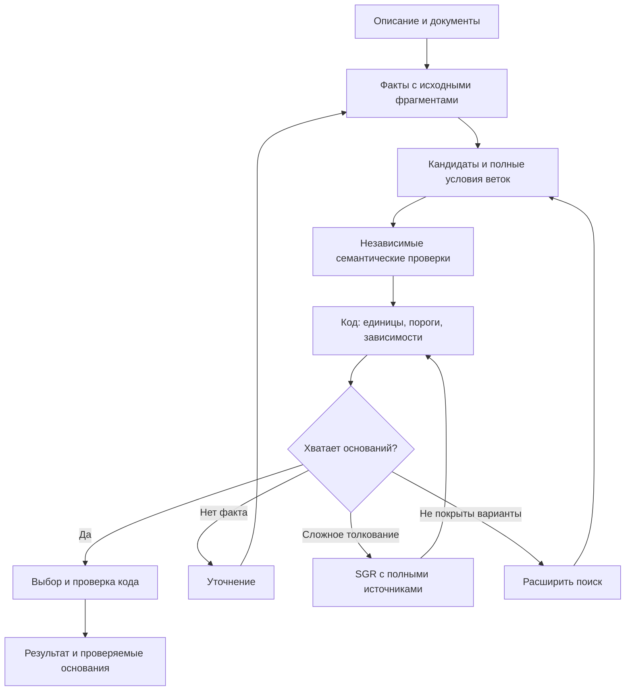

# Decision-модели и каскадный SGR для классификации ТН ВЭД

Дата исследования: **4 ноября 2026**. Изученная ревизия FEAP: `ca18883`.
Статус: исследовательское предложение; архитектура ниже не реализована и не проверена модельными прогонами.
Цены и характеристики — снимок опубликованной документации на дату исследования.

## Вывод

Идея применима к FEAP. Наиболее перспективно сочетание **SGR для подготовки и сложных рассуждений, decision-моделей для ограниченных семантических вопросов и кода для исполнения условий и управления поиском**.

Главный актив такого решения — проверенное представление различий между тарифными ветками: какие признаки нужны, откуда они взяты, какие условия обязательны, что пока неизвестно. Модель, оценивающая отдельный вопрос, становится заменяемым компонентом.

Начать следует с небольшого эксперимента на L4/L5 и проверки полноты кандидатов. Полная замена каскада одним decision-провайдером пока не обоснована. Обещать рост точности или конкретное ускорение до парного прогона нельзя.

## Что уже есть в FEAP

Профильные документы и код дают более сильную отправную точку, чем обычная классификация описания в один запрос.

| Наблюдение | Следствие для нового подхода |
|---|---|
| `choice_model()` связывает схему с допустимыми кодами конкретного запроса | Динамическое множество ответов уже существует; не нужно заранее обучать модель на каждом коде. См. [selection.py](../src/feap/cascade/selection.py). |
| L4/L5 запрашивают параметры, различия кодов и сравнения с порогами до решения | Часть этих операций можно представить отдельными типизированными проверками. См. [схемы L4](../src/feap/schemas/subposition.py), [L5](../src/feap/schemas/subsubposition.py). |
| v32 ввёл `supported / contradicted / unknown`, ссылки `source_ids`, ограниченный repair и уточнения | Это основа протокола доказательств, но пока без независимой проверки смысла цитат. См. [evidence.py](../src/feap/cascade/evidence.py). |
| L5 в режиме `legacy` при более чем пяти листьях сохраняет до двух восьмизначных веток; новые evidence-режимы передают все листья | Уже есть механизм сохранения альтернатив. Его нельзя представлять как новую оптимизацию или менять одновременно с моделью при первом сравнении. См. [level5.py](../src/feap/cascade/levels/level5.py). |
| Итоговый confidence — минимум по цепочке; review включается при значении ниже 0.6 или risk flags | Вероятности нового провайдера нельзя без проверки подставить в старый контракт. См. [validator.py](../src/feap/cascade/validator.py). |

У проекта есть три особенно важных эмпирических урока:

1. **Процедурный чеклист может ухудшать результат.** В истории DTN переход v21 → v22 → v23 сопровождался падением code-10 с 74% до 69% и 59%. Рабочие поля о свойствах товара оказались полезнее абстрактных указаний о навигации. Это локальный исторический результат, а не универсальный закон о SGR. [История DTN](dtn_decision_tree_navigation.md).
2. **Ошибки интерфейса и данных легко принять за слабость модели.** В v30/v31 исправлялись подмена выбранного кода, привязка confidence к другому кандидату и отсутствие ограничений конкретного дерева. В v32 обнаружена потеря родительских условий у пиломатериалов. Decision-модель не исправит неверную входную ветку или потерянное условие. [v30](sgr_v30_analysis.md), [v31](sgr_v31_validation.md), [v32](sgr_v32_validation.md).
3. **Качество решения и качество сигнала неопределённости нужно измерять отдельно.** Пересчёт старых прогнозов по бенчмарку v2 дал для v32 baseline 79 верных, 1 остановку/помеченную ошибку и 8 тихих ошибок на 88 оцениваемых случаях. После v31 высокая уверенность встречается и у ошибок. Это не те же знаменатели, что исторические 79/100 или 80/89. [Бенчмарк v2](benchmark_v2_design.md).

`SGR_EVIDENCE_POLICY` по умолчанию остаётся `legacy`. Новые режимы экспериментальны: полный выигрыш не доказан, часть сравнений испорчена бюджетными отказами. Набор `v32_reviewed89` также не является окончательным gold: H30 остался спорным. [Границы проверки v32](sgr_v32_validation.md), [повторная проверка эталонов](sgr_v32_label_recheck.md).

Из общего [AGENT_ENGINEERING.md](AGENT_ENGINEERING.md) здесь полезны разделение SGR/context/harness, проверяемые контракты, происхождение фактов и измерение изменений. Этот документ описывает также другой агентный контекст; его частные правила не следует автоматически переносить в классификатор.

## Что именно дают decision-модели

В основном обсуждаемом варианте модель получает `state`, вопрос и описанные варианты ответа. Она вычисляет оценки вариантов без длинной авторегрессионной генерации. Возможные ответы задаются **на момент запроса**, а не обязательно зашиваются в веса при обучении.

Поэтому известными заранее должны быть варианты очередного решения: дети текущего узла, несколько извлечённых значений, номера фрагментов или статусы проверки. Не требуется заранее перечислять все возможные товары и все пользовательские описания.

Есть несколько реализаций этой идеи:

| Семейство | Механика | Практический смысл |
|---|---|---|
| Encoder + classification/option head | BERT-подобный encoder и оценки вариантов | Малые модели, полезны для коротких специализированных проверок. |
| Decoder в режиме prefill + pointer head | LLM читает вход, голова оценивает позиции вариантов | Можно сохранить языковые способности базы и убрать длинный вывод. |
| Чтение logits букв ответов | Варианты обозначаются A/B/C; читаются logits этих токенов | Нужный контрольный baseline: специальное обучение требуется не всегда. |
| Decision + условное reasoning | Быстрый ответ; дополнительное рассуждение по отдельной политике | Компромисс качества и стоимости, но возвращаются задержка и ошибки маршрутизации. |

Техническая новизна не в самом существовании классификатора. Значимы универсальная постановка вопроса, динамические варианты, распределение ответов и оптимизированный inference. Закрытая архитектура Jev не позволяет считать любую открытую реализацию её точной копией. Исследование Jeff показывает конкурентоспособность простого чтения logits и последующего LoRA-обучения. [Releasing the Inner Jev](https://arxiv.org/abs/2610.17205).

Есть и расширения за пределы чистого выбора: документация Liquid d1-2B описывает извлечение значений со span, чисел и дат, а также multimodal outputs. Поэтому тезис «все decision-модели умеют только выбрать заранее написанный текст» уже слишком узок. Для FEAP базовый переносимый контракт всё равно разумно строить вокруг выбора и проверяемых свидетельств. [d1-2B](https://docs.liquid.ai/lfm/models/d1-2b).

**SGR и независимые вопросы — разные вычислительные конструкции.** В SGR порядок полей позволяет сгенерированному промежуточному анализу стать контекстом последующего решения. В Jev вопросы одного запроса независимы. Поставить вопрос о материале перед вопросом о коде недостаточно: второй не прочитает первый ответ. Для реальной зависимости нужны последовательные вызовы либо применение результатов в коде. [SGR Patterns](https://abdullin.com/schema-guided-reasoning/patterns), [TypeSafe primitives](https://docs.typesafe.ai/primitives).

Уместен и speculative fan-out: одновременно проверить несколько независимых признаков для разных веток, затем использовать только релевантные. Но нельзя считать это способом передать ответ одного вопроса другому. [Паттерн TypeSafe](https://docs.typesafe.ai/patterns/fan-out).

## Провайдеры для сравнения

Цены ниже — USD за миллион входных токенов; у перечисленных decision-endpoints вывод бесплатен. Это не стоимость классификации товара: биллинг общего контекста, число вопросов и дополнительные этапы различаются.

| Решение | Публичная цена | Существенные особенности | Роль в эксперименте FEAP |
|---|---:|---|---|
| **TypeSafe Jev 1.14.0** | **0.042** | Закрытая API-модель; default limits 64k на запрос / 32k на вопрос, до 255 Choice-вариантов. Нет отдельного лимита числа вопросов сверх токеновых лимитов. Зафиксировать version ID. | Основной hosted baseline нового подхода. [Models](https://docs.typesafe.ai/models), [Choice](https://docs.typesafe.ai/primitives/choice). |
| **Liquid d1.1 / d1-ultra** | **0.02 / 0.042** | Hosted text/vision. Каждый вопрос тарифицируется как отдельный prompt с соответствующим входом. d1.1 и d1-ultra нельзя смешивать с более ранним d1 в сравнении. | d1.1 — стоимость; ultra — качество. [Pricing](https://www.liquid.ai/pricing), [API models](https://docs.liquid.ai/lfm/models/decision-models). |
| **Cloudflare Clef-Flash / Clef** | **0.038 / 0.24** | Hosted и открытые веса; 9B/27B, Apache-2.0. Hosted context: 24,576 / 65,536 токенов. | Flash — быстрый вариант; Clef — более крупный контроль. [Flash](https://developers.cloudflare.com/workers-ai/models/clef-flash/), [Clef](https://developers.cloudflare.com/workers-ai/models/clef/), [архитектура и лицензия](https://blog.cloudflare.com/clef-decision-models/). |
| **Microsoft-Decision-1** | **0.042** | Foundry и OpenRouter, text/JSON; post-training Qwen3.5-9B. Объявление провайдера о превосходстве требует проверки на нашем наборе. | Дополнительный backend, особенно при использовании Azure. [Анонс](https://commandline.microsoft.com/microsoft-decision-1-model-foundry/), [документация](https://learn.microsoft.com/en-us/azure/foundry/foundry-models/how-to/use-foundry-models-microsoft-decision). |
| **OpenAI Decisions / gpt-6-luna** | **0.10**, без кеша | Отдельный `/v1/decisions`, text/images/JSON, 1–400 вопросов; есть prompt caching. Условия regional/long-context pricing применяются отдельно. | Контроль качества и возможностей API. [Официальная документация](https://developers.openai.com/api/docs/guides/decisions). |
| **Inception Mercury Decide** | **0.02**, показано как акция 50% | Typed decisions; не переносить на него характеристики генеративного Mercury. | Дополнительный ценовой контроль после первых трёх моделей. [Страница провайдера](https://www.inceptionlabs.ai/). |

Для первой итерации достаточно Jev, d1-ultra и Clef-Flash плюс текущий SGR. d1.1 можно добавить как дешёвый вариант. Массовый прогон всех доступных моделей увеличит стоимость исследования и число случайных побед.

Для FEAP существенна доступность части моделей через существующего агрегатора, но **замены `model_override` недостаточно**: нынешний `LLMProvider.classify()` ожидает генерацию Pydantic-объекта с текстовыми аналитическими полями. Нужен отдельный адаптер decision-запросов и их распределений. Например, OpenRouter описывает d1.1 как System One-модель, а decision-маршрут отличается от chat completions. [Контракт FEAP](../src/feap/llm/provider.py), [d1.1 на OpenRouter](https://openrouter.ai/liquid/d1.1/), [пример decision-endpoint](https://openrouter.ai/upstage/solar-decide/providers).

## Открытые решения

| Семейство | Что проверено по первоисточнику | Вывод для FEAP |
|---|---|---|
| **Kev** | Семейство Qwen 0.8B/4B/9B/27B, pointer head, собственное обучение и Jev-совместимый сервер, Apache-2.0. [Репозиторий](https://github.com/jaredpalmer/kev). | Хороший кандидат для обучения на наших проверках и локального обслуживания. Начать с 4B/9B, размер выбирать по замерам. |
| **Laya** | English ModernBERT около 421M и multilingual mmBERT около 322M; Apache-2.0. Дефолтные бюджеты короткие; multilingual допускает увеличение до 8192. [Model card](https://huggingface.co/convaiinnovations/laya). | Рассматривать как основу для специализированных RU-проверок. Root English не подходит как универсальный русский классификатор. |
| **Strands Decider** | Открытый код Apache-2.0, Qwen3.5-2B и семейство Gemma, pointer head, обучение/оценка/serving. [Репозиторий](https://github.com/strands-labs/strands-decider). | Полезная альтернативная реализация и контроль для Kev, особенно если нужен небольшой размер. |
| **Jeff 1.0/1.1** | Семейство Gemma/Qwen. У текущего сервера 16 answer slots; большие списки обрабатываются турниром. Контекст 8192; длинный вход может сокращаться автоматически. [Репозиторий](https://github.com/j-geuter/Jeff). | Сильный исследовательский baseline. Для юридического контекста включать отказ при переполнении, а не незаметное сокращение. Турнир — отдельный источник потери кандидата. |
| **Jeeves** | Qwen3.5-9B, решение с условным reasoning, код MIT. В README есть замеры с/без thinking и ограничения сравнения. [Репозиторий PostHog](https://github.com/PostHog/jeeves). | Интересен как готовый гибрид. Уверенная ошибка может не включить reasoning; нужен внешний контроль полноты фактов. |
| **Clef / Clef-Flash** | Открытые веса Apache-2.0, Qwen backbone, decision heads. [Cloudflare](https://blog.cloudflare.com/clef-decision-models/). | Возможность сравнить hosted и собственный runtime одной семьи. Проверять совпадение ревизий и квантизации. |
| **Liquid d1-2B / d1-omni-2B; d1-3B как предыдущая версия** | Текущая документация рекомендует d1-2B; есть извлечение со span и мультимодальность. Лицензия LFM Open License, а не Apache. [Семейство](https://docs.liquid.ai/lfm/models/decision-models), [условия лицензирования](https://www.liquid.ai/pricing). | Кандидат для компактного извлечения фактов и локальных вопросов. Коммерческие условия зависят от лицензии и масштаба компании; открытые веса не равны отсутствию ограничений. |
| **GLiClass / NLI baseline** | GLiClass поддерживает классификацию по переданным labels, есть открытые модели и код. [Репозиторий](https://github.com/Knowledgator/GLiClass). | Нужный контроль: простой классификатор entailment может оказаться достаточным для узкой проверки признака. |

Рекламный результат Laya 76.6% на typed-decisions относится к специализированному checkpoint. На той же странице base даёт 36.2%, multilingual — 34.2%; сравнение не доказывает универсального превосходства над Jev. Это наглядная причина сохранять checkpoint, task, split и calibration recipe рядом с каждым числом. [Model card Laya](https://huggingface.co/convaiinnovations/laya).

У Jeff следует отдельно проверять лицензию выбранных весов и базовой модели; лицензия serving-кода не заменяет её. Самостоятельное размещение любого семейства добавляет стоимость оборудования, загрузки, простоя и эксплуатации. При низком трафике дешёвый API может быть выгоднее локальной модели.

## Что говорят бенчмарки

Ниже — разные виды свидетельств. Их показатели нельзя складывать в одну таблицу «процент правильных ответов».

| Источник | Результат | Что можно заключить |
|---|---|---|
| **Artificial Analysis Decision Index**, независимый от провайдеров измеритель | На просмотренных страницах: d1-ultra **65**, Jev 1.14 **57**; median task latency **93 / 78 мс**. [d1-ultra](https://artificialanalysis.ai/decision-models/d1-ultra), [Jev](https://artificialanalysis.ai/decision-models/jev-1-14). | Есть конкурентные hosted варианты. Баллы индекса не являются точностью ТН ВЭД; измерения latency относятся к нагрузке и окружению AA. |
| **Методика AA** | Композит знаний, reasoning, tool calling и safety classification. [Методика индекса](https://artificialanalysis.ai/evaluations/artificial-analysis-decision-index). | В индексе нет целевого теста российского юридического языка и десятизначной ТН ВЭД ЕАЭС. |
| **Evaluating and Benchmarking Jev**, исследовательский препринт | Jev 1.13.0: 37 датасетов, 346,009 запросов; хорошие результаты на ряде классификаций. На UNFAIR-ToS настройка binary thresholds повышала micro-F1 с 0.50 до 0.75. [Статья](https://arxiv.org/abs/2609.37647). | Калибровка и порог зависят от задачи и типа вопроса. Старые результаты 1.13 не следует приписывать 1.14. |
| **Releasing the Inner Jev**, авторы открытых моделей | На OpenDecisions: zero-shot Gemma 4 31B **79.6**, Jev **80.1**, fine-tuned вариант **84.4 Capability**; на JevBench v1.7 — **81.5**. [Статья](https://arxiv.org/abs/2610.17205). | Надо сравнивать не только брендированные decision-модели, но и простой readout. Capability — составная метрика, не accuracy. |
| **What Can't Jev Decide?**, препринт | В исследованном наборе 97.5% на задачах, решаемых reference LLM за один проход, и 74% на остальных; устаревшая сводка вызывала ошибки, которые confidence не выявлял. [Статья](https://arxiv.org/abs/2610.24929). | Особенно опасно дать модели ошибочную L0-карточку вместо свидетельств. Это экспериментальное ограничение на данных авторов, а не доказательство невозможности любого сложного решения. |
| **Candidate coverage and rejection transfer**, препринт | Политика отказа, откалиброванная на одном наборе, могла резко терять полезность на другом; исследованы также retrieval misses. [Статья, v2](https://arxiv.org/abs/2610.03387). | `none_of_the_above` и порог уверенности нельзя считать надёжной страховкой потери нужного кода. |
| **Multiple correct choices**, препринт | У Jev, d1 и GPT-6 Luna обнаружена неравномерность распределения массы между несколькими правильными вариантами, включая копии. [Статья](https://arxiv.org/abs/2610.29217). | Один Choice неудобен для получения списка всех допустимых гипотез при неполных данных; нужны отдельные проверки и измерение recall. |
| **Good Judgment, Bad Advice**, препринт | На 21 held-out terminal-задаче, 315 trials, Jev-контроллер увеличил стоимость попытки на 19% при той же доле успеха. [Статья](https://arxiv.org/abs/2610.24649). | Даже дешёвый полезный сигнал может запускать лишние дорогие действия. Для FEAP измерять весь маршрут, включая проверки и эскалации. |

Цифры Cloudflare, Liquid, Kev, Strands и Jeeves в их model cards полезны для воспроизведения, но являются измерениями авторов. Не следует сопоставлять локальный GPU forward-pass с полным HTTP-вызовом другого поставщика или разные версии JevBench. Часть исследований появилась совсем недавно; независимое воспроизведение ограничено.

## Варианты архитектуры

| Вариант | Что меняется | Достоинство | Главный риск | Приоритет |
|---|---|---|---|---|
| **A. Прямая замена отдельных выборов** | В одном уровне SGR заменяется на Choice с теми же кодами и контекстом | Быстро проверить, сколько даёт сам inference | Потеря полезного промежуточного reasoning | Обязательный baseline |
| **B. SGR извлекает факты → decision выбирает** | Короткая карточка с источниками, затем ограниченный выбор | Небольшая сложность интеграции | Ошибка извлечения становится общей для всех следующих шагов | Первый гибрид |
| **C. Проверенные условия веток → атомарные оценки → код** | Переиспользуемые условия, evidence, числовые сравнения и политика неизвестности | Больше проверяемости и повторного использования | Неполная или неверная компиляция правил | Предпочтительная целевая архитектура |
| **D. Decision-поиск по нескольким веткам + SGR для сложного остатка** | Beam и ограниченный fallback | Снижает влияние раннего ошибочного выбора | Цена множества путей; плохой gate пропускает уверенные ошибки | Добавлять после B/C |
| **E. Decision-признаки → обучаемый reranker/gate** | Из вероятностей проверок обучается компактная модель | Может использовать корреляции сигналов лучше ручной суммы | Нужны хорошие независимые labels; shortcut learning | После накопления данных |
| **F. Дистилляция собственных проверок** | Fine-tune Kev/Laya/Decider на исходных свидетельствах и экспертных решениях | Контроль стоимости и доменного качества | Дистилляция ошибок учителя, переобучение на товарные семейства | Следующий этап |

Вариант E близок идее «собрать поинты и выбирать на их основе». У TypeSafe есть воспроизводимый пример, где LLM предлагает вопросы, Jev превращает текст в признаки, CatBoost учится на них. Но это пример регрессии оценок вина, а не юридического вывода. В FEAP такой слой логичнее использовать для ranking и выбора эскалации; обязательные условия остаются отдельными. [Feature discovery cookbook](https://docs.typesafe.ai/cookbooks/autoresearch_feature_discovery).

## Предпочтительный движок: подготовка правил и исполнение

### Подготовка различающих условий

Дорогую работу имеет смысл выполнять при подготовке ветки или изменении справочника, а не заново для каждого товара.

Вход: действующие тексты кодов с полными родительскими условиями, примечания, применимые определения и классификационные решения. SGR предлагает структурированное описание различий. Затем проходят проверки ссылок, структуры, логики границ и предметная проверка для автоматизируемых веток.

Пример внутреннего представления, **не готовая тарифная норма**:

```yaml
rule_id: branch_example.power_upper_bound
reference_snapshot: ett_snapshot_id
scope:
  parent_code: parent_from_reference
  candidate_ids: [candidate_a, candidate_b]
required_facts:
  - rated_output_power
  - motor_kind
numeric_condition:
  fact: rated_output_power
  operator: le
  value: "7.5"
  unit: kW
semantic_conditions:
  - fact: motor_kind
    expected: asynchronous
source_refs:
  - reference_document_id_and_span
unknown_action: ask_or_defer
validation_status: draft
```

Для каждого условия нужны scope, provenance и версия. Нельзя объединить все фразы со словом «мощность»: входная/выходная, номинальная/пиковая, кВт/кВА имеют разный смысл. Веса, состав и назначение тоже относятся к конкретной части изделия и определению.

Компилятор должен отдельно представить:

- Обязательные признаки и альтернативные условия.
- Исключения и ссылки в другие группы.
- Область действия родительского условия и соответствующий уровень иерархии.
- Числовые интервалы с включёнными/исключёнными границами и единицами.
- Различие между остаточной тарифной веткой и отсутствием подходящего варианта в текущем наборе.
- Условия, которые пока нельзя безопасно выполнить машинно.

Наличие реальной цитаты не доказывает, что компилятор верно выразил её смысл или нашёл все исключения. Новое правило нельзя автоматически активировать только потому, что JSON прошёл валидацию. Непроверенная ветка сохраняет маршрут через текущий SGR и проверку человеком по существующему процессу продукта.

### Исполнение для конкретного товара



1. **Собрать свидетельства.** Regex/парсер извлекает числа и единицы; компактная модель помогает с текстовыми свойствами. Хранятся исходный span, документ, единица и статус. Нормализованное значение не становится независимым источником. Сведения из карточки производителя отдельно сопоставляются с конкретной моделью товара.
2. **Получить кандидатов с высоким recall.** Текущий каскад можно дополнить поиском по полным текстам и альтернативным веткам. Для небольшого числа детей лучше оценить всех, чем рано отсечь правильный вариант. При большом числе — измерять recall каждого сокращения.
3. **Загрузить условия, относящиеся к оставшимся вариантам.** Одинаковый признак проверяется один раз в одном смысловом scope. Требование к всей машине и требование к её части не дедуплицируются как одно.
4. **Оценить атомарные семантические отношения.** Например: подтверждает ли конкретный фрагмент асинхронный тип двигателя; относится ли указанный материал к наружной поверхности; присутствует ли указание на специальное назначение. Кандидатами могут быть и существующие `source_ids`.
5. **Выполнить детерминированную часть.** Перевести Вт в кВт, проверить `<=`, соединить условия, выявить конфликт свидетельств. Числовая проверка корректна только после установления правильного физического параметра и единицы.
6. **Выбрать следующий шаг.** Допустить решение, запросить различающий факт, расширить поиск либо передать сложное толкование SGR. Количество повторов, расширений и вызовов ограничено бюджетом.
7. **Сформировать объяснение из trace.** Указаны использованные факты, условия и источники. Генеративная модель может улучшить формулировку, но не должна добавлять новые основания после выбора.

Если исходных данных достаточно для формального выбора и остаётся один допустимый лист, дополнительная модель выбора не нужна. Если один лист остался только после вероятностного отсечения других, это ещё не такое доказательство.

### Как должен выглядеть вопрос

Предпочтительно: «Что исходные фрагменты позволяют утверждать о наличии признака X?» с вариантами:

| Ответ | Значение |
|---|---|
| `supported` | Представленные свидетельства подтверждают условие. |
| `contradicted` | Свидетельства явно противоречат условию. |
| `unknown` | Сведений недостаточно для одного из предыдущих выводов. |

Противоречие между документами хранится отдельно как `conflict`, либо становится четвёртым состоянием контракта. Выбранный статус имеет свою вероятность; «вероятность unknown высока» означает уверенное обнаружение нехватки данных.

Неудачная замена: «Товар относится к коду X?» для каждого X без точного описания условия. Это лишь повтор исходной сложной задачи. Также нельзя превращать `P(yes)=0.49` в доказанное отсутствие признака или считать `unknown` слабой версией `contradicted`.

**Чеклист должен описывать различающие факты.** «Проверь корректность предыдущего решения» слишком широко. «Указан ли в источнике именно номинальный выходной параметр?» — проверяемый вопрос, ответ которого действительно меняет маршрут.

## Почему ТН ВЭД требует большего, чем дерева категорий

По ОПИ 1 названия разделов и групп служат навигации; юридическая классификация опирается на тексты позиций и соответствующие примечания. ОПИ 6 требует учитывать уровень сравниваемых субпозиций. Следовательно, L1/L2 полезны для поиска, но их семантический score не должен сам по себе становиться безусловным юридическим запретом другой ветки. [Официальные ОПИ ЕЭК](https://eec.eaeunion.org/upload/files/catr/ett/%D0%9E%D0%9F%D0%98_%D1%81%D0%BE%D0%BA%D1%80%D0%B0%D1%89%D0%B5%D0%BD%D0%B8%D1%8F_%D0%B4%D0%BE%D0%BF.%D0%B5%D0%B4.%D0%B8%D0%B7%D0%BC.pdf).

Из этого следуют требования к проектированию:

- Структура исполнения — граф зависимостей и исключений поверх тарифного дерева.
- Сравнение листьев из разных промежуточных веток сохраняет все родительские условия и нормативный порядок сравнения. Финальный rerank — помощник, а не замена ОПИ.
- Правильные признаки не складываются в «очки», компенсирующие нарушенное обязательное условие. Пять совпадений не перекрывают одно достоверное исключение.
- «Прочие» — конкретная остаточная ветка своего scope. Это не общий ответ «не знаю» и не аналог `none_of_the_above`.
- Действительность норм и кодов проверяется на выбранную дату. Изменение справочника инвалидирует связанные условия и кеши.

Комплекты, смеси, многофункциональные изделия, части и специальное назначение могут требовать интерпретации, не сводимой к надёжным атомам. Универсальный runtime реалистичен; полностью автоматическая и безошибочная компиляция всей номенклатуры из текста пока не подтверждена.

Показателен ваш H30: число динамиков не разрешило вопрос о функции устройства, микрофоне и применимости классификационного решения. Быстрый движок должен обнаружить недостающий признак или необходимость толкования, а не ускорить прежнее угадывание. [Повторная проверка H30](sgr_v32_label_recheck.md).

## Распределения, несколько веток и политика риска

### Три разных сигнала

Следует хранить раздельно:

1. Распределение модели по представленным вариантам.
2. Статус достаточности и непротиворечивости исходных фактов.
3. Оценку риска ошибки всего классификатора на соответствующем типе входа.

Для Choice у Jev `confidence = (p_max - 1/n) / (1 - 1/n)`. Это преобразование верхней вероятности с учётом числа вариантов, а не второе независимое свидетельство и не готовая вероятность верного десятизначного кода. Использовать raw distribution и отдельно калибровать итоговое событие. [Формула TypeSafe](https://docs.typesafe.ai/confidence).

Даже хорошо откалиброванное распределение на benchmark не гарантирует такой же калибровки на русских инвойсах, с другими описаниями вариантов и отсутствующим правильным ответом. При смене модели, языка, вопросов, размера shortlist, quantization или версии справочника калибровку нужно повторно оценивать.

Открытые ограничения Jev включают числа, даты, многозвенные зависимости, лишний контекст, порядок вариантов и влияние инструкций внутри данных. Это согласуется с переносом арифметики в код и необходимостью контролировать исходное evidence. [Model jaggedness](https://docs.typesafe.ai/model-jaggedness).

### Полнота кандидатов

Если правильного кода нет в предложенном множестве, нормированное распределение всё равно суммируется в единицу. Верхняя вероятность не свидетельствует о полноте поиска. Если движок не умеет выйти за множество C, его точность ограничена вероятностью попадания эталона в C.

Полезны `outside_candidates` и отдельная проверка «есть ли среди вариантов подходящий», но обе модели могут ошибаться вместе. Проверка покрытия дополняется независимым поисковым каналом, сохранёнными альтернативами и отказом при неполном справочном контексте.

В диагностике v32 L5a при правильном шестизначном родителе покрывал правильную восьмизначную ветку в 20/24 случаях первым выбором и в 23/24 через top-2. Это маленькая условная выборка, но конкретное основание исследовать сохранение альтернатив. [v32](sgr_v32_validation.md).

### Beam search

Официальный cookbook TypeSafe уже показывает классификацию иерархий через parallel beam search. Значит, сама конструкция «decision-модель + несколько путей» практически реализуема. Однако его геометрическое среднее вероятностей — ranking score, а не вероятность юридически верного кода. [Hierarchical classification](https://docs.typesafe.ai/cookbooks/hierarchical_classification).

Для FEAP разумно проверить ширину 1/2/4, затем адаптивное расширение при близких оценках, неизвестном различающем признаке или подозрении на пропущенную ветку. Сохранять причину удаления каждого пути. Нельзя отсекать по `unknown`; подтверждённое детерминированное противоречие — гораздо более сильное основание.

Произведение оценок по пути корректно интерпретируется как вероятность только при корректных условных вероятностях и согласованном пространстве событий. Набор модельных scores этим требованиям автоматически не удовлетворяет. Нельзя также перемножать вероятности похожих проверок как независимых: они могут опираться на одну и ту же ошибочную фразу.

### Как выбирать уточнение и эскалацию

Лучшее уточнение — доступный пользователю признак, который меняет допустимые коды или последствия ошибки. Начальный алгоритм может выбирать вопрос, разделяющий больше оставшихся вариантов; позднее — учитывать ожидаемое уменьшение риска, стоимость ответа и количество уже заданных вопросов.

Гейт эскалации должен учитывать не только вероятность, но и missing facts, conflict, полноту условий, качество retrieval и сложность применимого правила. Самооценка «мне легко» не заменяет этих сигналов.

Финансовые последствия влияют на необходимость проверки, а не на выбор более выгодного кода. Классификация определяется товаром и правилами.

## Экономика

Оценивать надо стоимость **правильного завершённого случая при заданной доле тихих ошибок**, вместе с уточнениями и fallback:

```text
C_total = C_extract + C_retrieve + C_decisions + C_explanation
          + P(fallback) × C_fallback
          + C_rule_preparation / число использований
          + C_serving
```

Условный пример, не результат FEAP: 25,000 тарифицируемых токенов decision-этапов при $0.042/M стоят **$0.00105**. Если извлечение стоит $0.003, а 10% случаев требуют дополнительного SGR за $0.02, получается **$0.00605** до прочих расходов. Против условного baseline $0.02 это около **3.3×**, а не обещание стократного удешевления. При fallback 50% тот же расчёт даёт $0.01405; выгода заметно сужается.

В [бенчмарке v2](benchmark_v2_design.md) есть реальный замер $0.069 на трёх dev-случаях, около $0.023/случай. Три товара не устанавливают среднюю цену продукта. [Мартовский отчёт](token_economics_report.md) полезен как история структуры расходов, но не как актуальный прайс или baseline ноября.

Отдельно проверять **единицу биллинга**. TypeSafe в своём примере пакетных вопросов показывает однократный учёт общего документа; Liquid описывает каждый вопрос как отдельный тарифицируемый prompt. Для условного state 3000 токенов и 20 вопросов по 150 токенов общий вход составляет 6000 токенов при однократном учёте state и 63,000 при повторном. При ставках $0.042/M и $0.02/M это соответственно $0.000252 и $0.00126 — более низкая ставка может дать более дорогой запрос. Это арифметическая иллюстрация; считать надо фактические `usage` и счёт конкретного endpoint, включая служебный overhead. [TypeSafe: parallel questions](https://docs.typesafe.ai/cookbooks/parallel_questions), [Liquid billing](https://docs.liquid.ai/lfm/models/decision-models).

Задержку определяет критический путь: извлечение + последовательные раунды решений + поиск + возможный SGR. Независимые вопросы можно объединять, зависимые требуют следующего раунда. Median одной модели не является p95 полного каскада. При измерении учитывать сеть из окружения продукта, cold start, rate limits и retries.

Экономить следует также на числе уникальных проверок: извлечь факт один раз, переиспользовать между кандидатами, передавать только относящиеся к вопросу источники. Но сокращение контекста не должно терять условие или исключение.

## Эксперимент, который действительно проверит гипотезу

### Данные уже есть

По [документации бенчмарка v2](benchmark_v2_design.md) подготовлены:

| Набор | Назначение |
|---|---|
| `eaeu_pd_dev150` | Разработка вопросов, разбор ошибок и выбор архитектуры. |
| `eaeu_pd_test400` | Закрытая сквозная проверка: реальные предварительные решения; достаточность опубликованного описания не установлена автоматически. |
| `eaeu_pd_test400_short` | Те же товары в кратком представлении: проверка недостающих фактов и уточнений. Не 400 новых независимых объектов. |
| `eec_decisions_test` | 67 случаев с эталонами разной глубины; нельзя считать каждый десятизначным gold. |
| `eec_decisions_dev` | Старые решения со статусом unverified; сначала проверка применимости к редакции справочника. |
| Старые 100 синтетических | Регрессия, исторические ошибки и протокол доказательств. |

Сборник предварительных решений содержит большой дополнительный пул; он пригоден для создания отдельного training/calibration набора после проверки качества и группового разделения. Нельзя использовать закрытый test для автоматического поиска чеклистов, обучения или подбора thresholds. Публичность решений также оставляет риск попадания в обучение foundation-моделей.

Нужен отдельный calibration split: по возможности разделять близкие товары, шаблоны описаний, семьи кодов и источники. Случайный split почти одинаковых товаров даст слишком оптимистичную оценку. На малой выборке не строить отдельный threshold для каждого из тысяч кодов.

### Последовательность сравнений

1. **Зафиксировать baseline.** Текущий код, реальные модели, evidence policy, снимок справочника, входы и бюджет. Никаких выводов из смешения v31/v32 и разных БД.
2. **Изолированный replay L4/L5.** Все модели получают одинаковые исходные факты, нормативный контекст и варианты. Сначала правильный родитель, затем предсказанный. Это отделяет ошибку выбора от ошибки предыдущего уровня.
3. **Ablation представления.** Сравнить текущий SGR и decision на одинаковом контексте; затем оба — на одинаковых подготовленных фактах/условиях. Иначе улучшение представления будет ошибочно приписано модели.
4. **Проверки условий.** На небольшой вручную проверенной группе веток измерить извлечение, смысловую поддержку и `unknown`. Затем добавить детерминированные пороги.
5. **Отдельно проверить beam и fallback.** Не менять одновременно модель, число вариантов, evidence policy и глубину поиска. При одинаковом бюджете сравнить ширину 1/2/4 и адаптивный вариант.
6. **Заморозить вопросы и gate.** Только после этого выполнить полный парный test, включая краткие описания и продолжение после уточнения.
7. **Shadow mode.** Новый путь сохраняет решения и расхождения, пока пользовательский результат выдаёт текущая проверенная конфигурация. Выборочную проверку делать и для уверенных совпадений: разбор одних расхождений пропустит общие ошибки.

### Метрики

- Точность по 4/6/8/10 знакам с учётом реальной глубины эталона; сквозная и условная на правильном родителе.
- Candidate recall@K до каждого отсечения и на уровне итоговых листьев.
- Четыре исхода из v2: верно / безопасная остановка / тихая ошибка / инфраструктурный сбой.
- Coverage, precision среди автоматически принятых, число вопросов, доля и цена fallback, p50/p95 полного маршрута.
- Brier/NLL для распределений, calibration curves и зависимость ошибки от coverage. Raw confidence провайдера и откалиброванный риск пайплайна хранить отдельно.
- Цена ошибки через существующие метрики платежей и мер, с фиксацией даты и ограничений справочника НТМ.
- Метрики отдельных фактов: supported/contradicted/unknown, source selection, numeric boundary, конфликт документов.

Парный bootstrap или McNemar выполнять по товарам; повторы и короткие версии одного товара не считать независимыми наблюдениями. Для вероятностей целевого code-10 не использовать старый ECE по heading: в [calibration.py](../benchmark/metrics/calibration.py) `use_heading=True` является значением по умолчанию; [paired.py](../benchmark/metrics/paired.py) уже содержит отдельные метрики десятизначного результата.

Нулевые ошибки на маленьком наборе недостаточны для заявления о надёжности. Например, при 0 ошибках на 300 независимых автоматически принятых случаях односторонняя 95% верхняя граница частоты ошибки около **0.994%** (`1 - 0.05^(1/300)`). Это расчёт при биномиальной модели, а не гарантия для новых классов или изменившегося распределения.

### Обязательные стресс-сценарии

| Изменение входа | Что проверяет |
|---|---|
| Удалить решающий признак | Система должна обнаружить недостаточность; совпадение с полным эталоном само по себе не означает обоснованный ответ. |
| Удалить правильный код из кандидатов | Способность расширить поиск/отказаться, а не уверенно выбрать оставшийся. |
| Переставить и перефразировать варианты; добавить дубль | Чувствительность к порядку, формулировке и распределению массы. |
| Изменить один существенный факт | Код или набор допустимых кодов должен измениться предсказуемо. |
| Значение ровно на границе, другая единица, десятичная запятая | Смысл параметра, нормализация и детерминированное сравнение. |
| Исходный документ противоречит L0-карточке | Карточка не должна подавлять первичное свидетельство. |
| Русский текст, EN/ZH-инвойс, транслитерация, OCR-шум | Доменный и языковой перенос. |
| Вход содержит просьбу выбрать конкретный код | Разделение инструкций приложения и описания товара как данных. |
| Пропущено родительское условие или обновлена норма | Проверка версии/полноты справочника и инвалидирование правил. |

## Минимальный технический объём первого прототипа

Не нужен новый общий агентный framework. Достаточны несколько интерфейсов рядом с существующим каскадом:

```text
DecisionBackend.evaluate(state, questions)
    -> distributions, model_revision, usage, timings

BranchPolicy
    -> candidate_ids, predicates, dependencies, reference_refs, version

EvidenceFact
    -> attribute, value, unit, source_refs, epistemic_status

DecisionTrace
    -> input_hashes, candidate_set, raw_scores, applied_rules,
       retained_paths, pruned_paths, missing_facts, next_action
```

Backend валидирует состав ответов, допустимость ключей, конечность и диапазон чисел, сумму распределения с допуском, отсутствующие вопросы, refusal и ошибку транспорта. Токеновое переполнение нельзя молча превращать в усечённую нормативную базу. У провайдеров различаются semantics confidence, multi-question execution, billing и обработка длинных входов; единый HTTP-формат этого не отменяет.

В trace и ключи кеша входят версия справочника и правил, фактическая ревизия модели, вопрос, множество и порядок вариантов, исходные фрагменты. После уточнения пересчитываются зависящие от нового факта узлы; старое предположение не сохраняется как установленный факт. Любая вероятность после фильтрации должна быть помечена как относящаяся к новому множеству вариантов.

Первый ограниченный прототип: **несколько проверенных семейств L4/L5, Jev/d1-ultra/Clef-Flash, исходный SGR как контроль, без обучения собственной модели**. Сначала проверить выигрыш в стоимости при сопоставимом качестве и уменьшение тихих ошибок при сопоставимом coverage. Собственное обучение оправдано после установления, какие проверки реально трудны и повторяются достаточно часто.

Условие продвижения: улучшение на независимых данных при заранее зафиксированном допуске по качеству и риску, работающие уточнения, отсутствие провалов отдельных языковых/товарных срезов и приемлемый p95. Порог выпуска задаётся по продуктовым последствиям ошибки и объёму валидации, а не копируется из документации провайдера.

**Рекомендация:** развивать универсальный исполнитель проверяемых условий с подключаемыми decision-моделями. Использовать SGR для подготовки предметных правил, сложных случаев и анализа ошибок. Самая сильная версия идеи — научиться дёшево устанавливать конкретные факты и явно управлять неизвестностью, сохраняя нормативные основания каждого перехода.
